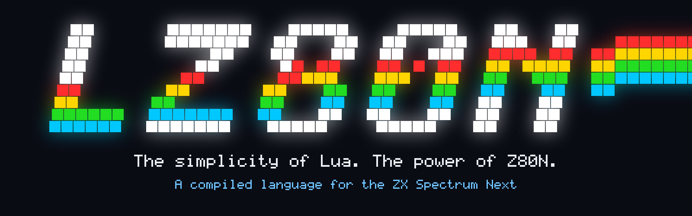

<p align="center">
  
</p>

# LZ80N — The Next Language

A statically typed, Lua-inspired language that compiles to native Z80N
machine code for the ZX Spectrum Next. No VM, no garbage collector.

Status: **v0, Phase 1 in progress** — a working command-line compiler for a
first language subset (typed variables, expressions, `if/while/for`,
functions, arrays, strings, `fixed` point numbers and math functions, structs, classes with methods, hardware sprites, Layer 2
graphics, palettes, AY sound and music, zxnDMA, copper, raster interrupts, tilemap text,
PNG assets, inline `asm`,
`nextreg[]`, `memory[]`, `print`/`write`/`at`, keyboard and Kempston input), a peephole optimizer, and an execution test
suite that runs the compiled `.nex` files in a built-in Z80N interpreter.

## Layout

```
compiler/        Rust compiler (lz80nc): lexer → parser → AST → checks + Z80N codegen
docs/spec-v0.md  what v0 implements and the decisions behind it
examples/        sample .lz80n programs
benchmarks/      the same tasks in LZ80N and NextBASIC
tools/sjasmplus  SjASMPlus 1.24.0 (not in the repository, see below)
```

## Documentation

* [Programmer's manual (English)](docs/manual-en.md)
* [Programozói kézikönyv (magyar)](docs/manual-hu.md)
* [Specification of v0](docs/spec-v0.md)

## Build and run

The compiler needs [SjASMPlus 1.24.0](https://github.com/z00m128/sjasmplus/releases/tag/v1.24.0)
(BSD licence). Put the Windows release into `tools/sjasmplus/sjasmplus-1.24.0.win/`
or pass `--sjasmplus PATH`.

```powershell
cd compiler
cargo build --release
cargo test
.\target\release\lz80nc.exe ..\examples\hello.lz80n      # -> hello.asm + hello.nex
```

Examples:

| File | Shows |
|------|-------|
| `hello.lz80n` | numbers, functions, `for`, border colours |
| `move.lz80n` | keyboard + Kempston input, `at` |
| `classes.lz80n` | structs, classes, methods, arrays of objects, by-reference params |
| `text.lz80n` | tilemap text layer: 40x32, built-in font, 16 inks |
| `layer2.lz80n` | Layer 2 bitmap: gradient, lines, rectangles, `point()`, layering with text and sprites |
| `math.lz80n` | `fixed` point, `sin`/`cos`/`atan2`/`sqrt`, gravity, Layer 2 double buffering |
| `palette.lz80n` | palette cycling animation, `dma_copy`, `addr()` |
| `raster.lz80n` | copper rainbow, `interrupt raster` / `interrupt frame`, `random()`, `cpu_speed()` |
| `strings.lz80n` | string values, `..`, `sub`/`find`/`upper`/`str`, user string functions, a ticker |
| `sound.lz80n` | 3 × AY: background music (`play_loop`), `beep` piano, laser and noise effects |
| `sprites.lz80n` | hardware sprites, PNG `asset` conversion, a class driving sprites |

`EXAMPLE=sprites FRAMES=120 cargo test render_example -- --ignored` renders
an example's display to `compiler/target/sprites.png` using the test emulator.

Run `examples\hello.nex` in an emulator (CSpect: `CSpect.exe -zxnext -w3 hello.nex`)
or copy it to the Next's SD card.

## Example

```lua
function square(byte x) -> word
    return x * x            -- byte * byte -> word, one MUL D,E
end

for i = 1, 10 do
    print(i, square(i))
end
```

See `docs/LZ80N.md` (concept document) for the full vision and roadmap.

## Benchmarks

`benchmarks/` holds the same seven tasks in LZ80N and NextBASIC
(`benchmark.lz80n`, `benchmark.bas`); see `benchmarks/README.md`.

## License

LZ80N is released under the [MIT License](LICENSE).
SjASMPlus, which the compiler calls, is a separate project under the BSD licence.
